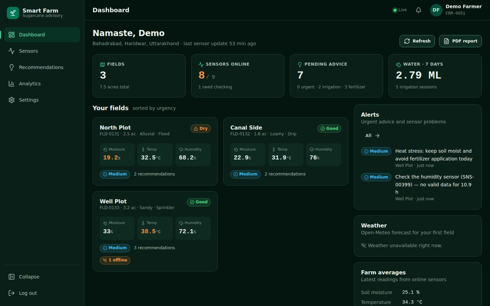
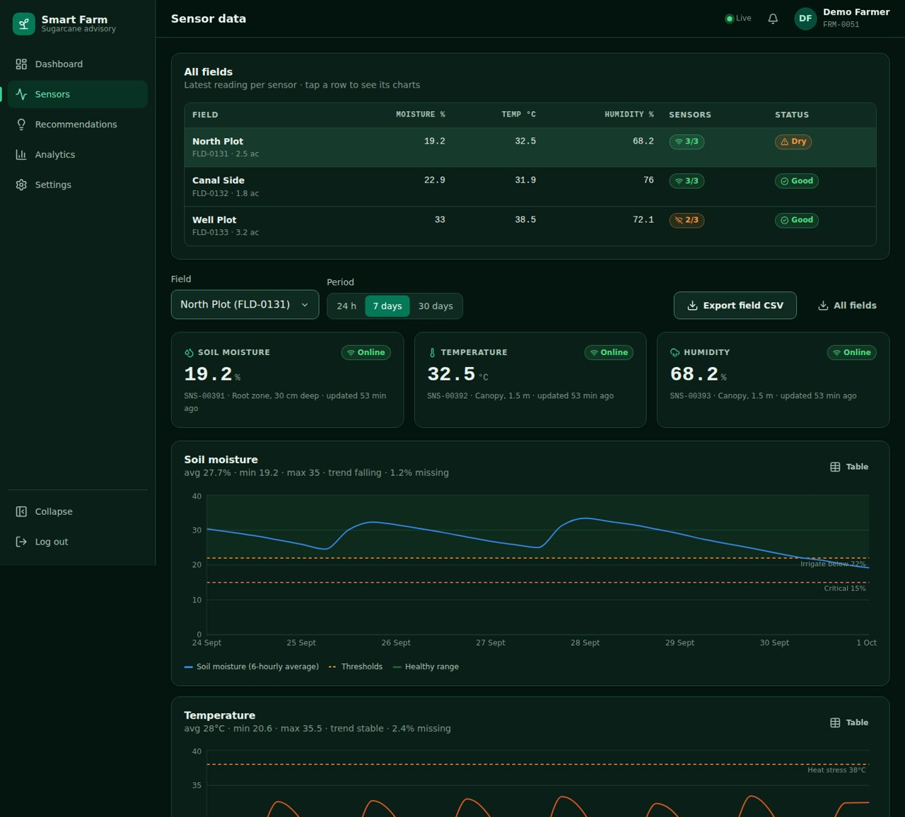
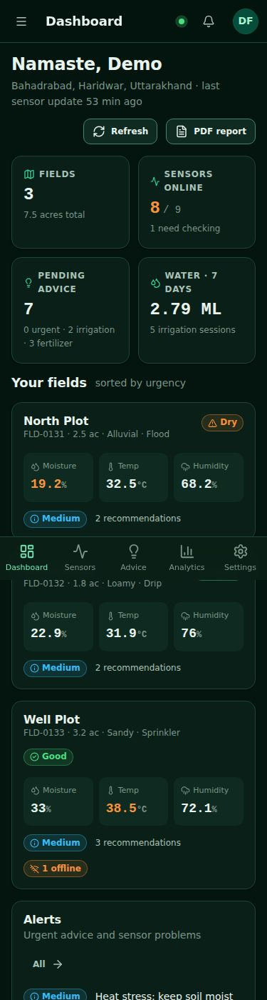
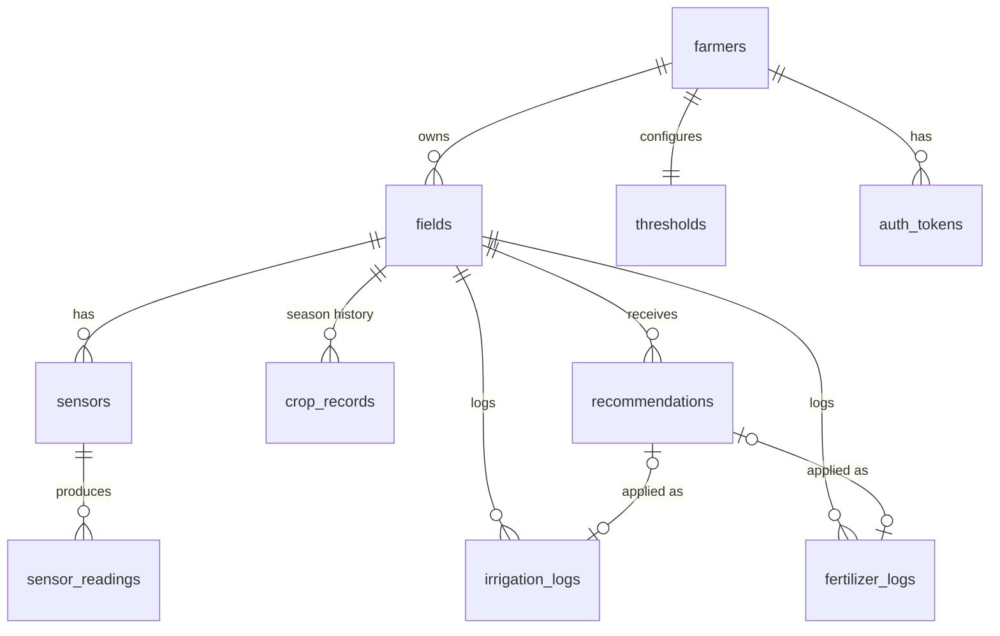

# 🌾 Smart Sugarcane Farm Advisory System

A full-stack web app that turns field-sensor data (soil moisture, temperature, humidity) and soil tests into **plain-language irrigation and fertilizer recommendations** for sugarcane farmers. It uses a dark-emerald, mobile-first UI and runs entirely on free hosting.

- **Frontend:** React 19 + Vite + Recharts, deployed to Cloudflare Pages
- **Backend:** Node 22 + Express, with JWT/bcrypt auth, Zod validation and Server-Sent Events, deployed to Render
- **Database:** PostgreSQL 16 on Neon, with a normalised schema, CHECK constraints, triggers and ACID transactions
- **Data:** your `SUGARCANE_FARMER_DATABASE.xlsx` (50 farmers, 130 fields, 3,000 crop records), imported and extended with synthesised sensor streams

| Dashboard | Sensors | Mobile |
|---|---|---|
|  |  |  |

More: [landing](docs/screenshots/landing.jpg) · [recommendations](docs/screenshots/recommendations.jpg) · [analytics](docs/screenshots/analytics.jpg) · [signup success](docs/screenshots/mobile-signup-success.jpg)

| Doc | What's inside |
|---|---|
| [`docs/DESIGN_SYSTEM.md`](docs/DESIGN_SYSTEM.md) | Phase 1: palette (hex/RGB/contrast), typography pairings, component specs, breakpoints |
| [`docs/HOSTING.md`](docs/HOSTING.md) | Phase 2: free-tier comparison (Oct 2026), recommendation, data-flow diagram |
| [`database/schema.sql`](database/schema.sql) | Phase 3: complete schema |
| [`docs/API.md`](docs/API.md) | Phase 4: all 48 endpoints, with request/response/error codes |
| [`docs/DEPLOYMENT.md`](docs/DEPLOYMENT.md) | Phase 8: step-by-step Neon → Render → Cloudflare, env vars, CI/CD, custom domain |

---

## Quick start (local, ~5 min)

**Prerequisites:** Node 20+ and PostgreSQL 15+. Either use a local install, run `docker run -d -p 5432:5432 -e POSTGRES_USER=farm -e POSTGRES_PASSWORD=farm -e POSTGRES_DB=smartfarm postgres:16`, or create a free Neon database.

```bash
# 1. backend
cd backend
cp .env.example .env            # edit DATABASE_URL if needed
npm install
npm run db:reset                # schema + seed (≈3 s)
npm run dev                     # → http://localhost:4000/api/health

# 2. frontend (new terminal)
cd frontend
npm install
npm run dev                     # → http://localhost:5173  (proxies /api to :4000)

# 3. optional: live sensor stream for the demo farmer
cd backend && npm run simulate -- --farmer FRM-0051 --interval 10

# 4. tests (19 end-to-end API tests)
cd backend && npm test
```

### Logins

| Account | Login | Password |
|---|---|---|
| Demo farmer (3 fields, lively data) | `demo@smartfarm.in` · `9000000051` · `FRM-0051` | `Demo@1234` |
| Any of the 50 farmers from your spreadsheet | their e-mail, phone or Farmer ID (e.g. `rajendra.pundir@farmerconnect.in`) | their `Farmer_Password` from the sheet |

---

## What's built

| Page | Highlights |
|---|---|
| **Landing** | Hero with a live-style recommendation card, features, how-it-works, CTA, footer |
| **Login** | E-mail / phone / Farmer ID, remember-me (30-day token), show-password, forgot-password link |
| **Signup** | Name, e-mail, phone, village, district, state, password + confirm with strength meter, T&C. **Farmer ID auto-generated by a DB sequence**, written in one transaction, shown on a confirmation screen, and the user is **auto-logged-in**. Optional e-mail verification |
| **Dashboard** | Stat cards (fields, sensors online, pending advice, water 7 d), field cards sorted by urgency, alerts, weather widget (Open-Meteo), farm averages, PDF report. Live updates over SSE |
| **Sensors** | All-fields status table, per-sensor health and missing %, 24 h / 7 d / 30 d charts with threshold lines and visible data gaps, table view, CSV export |
| **Recommendations** | Current advice by priority, a **"Why this recommendation?"** explanation, Mark-as-done (editable quantities → log) or Dismiss (reason), filters, history |
| **Analytics** | Daily trends, water per day, fertilizer by product, **yield history vs district**, linear yield forecast with a 95 % range, field comparison, advice-adoption rate |
| **Settings** | Profile, thresholds (re-evaluates every field on save), field CRUD (auto-creates 3 sensors), sensor management with device keys, CSV/PDF/e-mail export, password, verification, logout |

Components (`frontend/src/components`): `AppShell` (header, collapsible sidebar, mobile drawer + bottom tabs, live indicator), `ui.jsx` (Button, Input, PasswordInput, Select, Card, StatCard, Badge, PriorityBadge, Alert, Modal/bottom-sheet, Spinner, EmptyState, ErrorState, Segmented, ErrorBoundary), `charts.jsx` (MetricChart, CompareLines, Bars, ChartFrame with table toggle), Toast provider, Auth provider.

### Recommendation engine (`backend/src/services/engine.js`)

It runs after every sensor upload, on threshold changes, and on demand. Each output carries an `action`, an `explanation`, a `priority`, and `details` (inputs, thresholds, computed plan, confidence).

| Rule | Fires when | Output |
|---|---|---|
| `IRR_CRITICAL` / `IRR_LOW` | moisture < critical / < low (and no irrigation in the last 12 h) | Litres = deficit × root zone × area ÷ method efficiency (flood 60 %, sprinkler 75 %, drip 90 %); pumping time from pump flow; split if > 12 h. Heat raises the priority |
| `IRR_FORECAST` | moisture OK but the 24 h regression trend hits the low threshold within 24 h | "Plan irrigation within ~N h" |
| `IRR_WATERLOGGING` | moisture > high | Stop irrigating, open drains |
| `HEAT_STRESS` / `COLD_STRESS` | temperature outside limits | Timing advice, hold fertilizer |
| `DISEASE_RISK` | humidity > limit at 20–34 °C | Scout for red rot and smut |
| `FERT_N/P/K_LOW` | latest soil test below the minimum, and the product not applied in 21 days | Urea / DAP / MOP kg for the field, capped per-acre with split doses |
| `SENSOR_*` | no GOOD reading for 6 h | "Check sensor SNS-…". Dependent advice is paused |

**Missing data is handled explicitly.** Ingestion stores null, non-numeric and out-of-range values as `status='MISSING'` (enforced by a CHECK). The engine uses the newest GOOD value within 6 h and says so in the explanation ("the last 2 readings were missing…"), with reduced confidence. Beyond 6 h it raises a sensor alert instead of guessing. Charts draw gaps rather than interpolating.

### Database



These are the 7 core tables from the poster plus `crop_records` (from your sheet), `thresholds` and `auth_tokens`. Highlights:
- **IDs** come from sequences (`FRM-0001`).
- **CHECK constraints** cover the Indian mobile format, ranges, the GOOD-has-value / MISSING-has-null rule, and threshold ordering (`critical < low < target < high`).
- **Generated columns:** `farm_location`, `unit`, `applied`.
- **Triggers** maintain `sensors.last_reading`, create default thresholds and touch `updated_at`.
- **Partial unique index:** one PENDING recommendation per field and rule.
- **Indexes** on `(sensor_id, timestamp DESC)` and every FK.
- **Cascading deletes** throughout.
- **`v_sensor_status`** view classifies each sensor as ONLINE, STALE or NO_DATA.

### Seed data (from your spreadsheet)

`database/import_xlsx.py` converts the workbook into `backend/seed-data/*.json`. It **bcrypt-hashes the plaintext passwords**, recomputes the formula columns (field pH/EC, yield) from crop records, and derives each field's GPS location and irrigation method. `npm run db:seed` then loads:

| | Count |
|---|---|
| Farmers | 50 from the sheet + 1 demo |
| Fields | 130 + 3 demo |
| Crop records | 3,000 + 24 demo (8 seasons × 3 fields) |
| Sensors | 399 (3 per field) |
| Sensor readings | ~67,000 (14 days × every 2 h, ~2.6 % MISSING, a few ongoing outages) |
| Recommendations | ~630 historical (applied/dismissed) + ~140 current from the live engine |
| Irrigation / fertilizer logs | ~630 / ~65 |

The sensor streams are **synthesised**, because the workbook has no time-series. Each field's baseline comes from its own crop-record averages (moisture, temperature, humidity), with diurnal cycles, drying curves and irrigation events added on top. The generator is deterministic (seeded PRNG), so every reset gives the same data. Adjust it with `SEED_DAYS` / `SEED_STEP_H`.

To re-import an updated workbook: `pip install pandas openpyxl bcrypt && python database/import_xlsx.py path/to/SUGARCANE_FARMER_DATABASE.xlsx && cd backend && npm run db:reset`.

---

## Project structure

```
smart-farm-advisory/
├── database/
│   ├── schema.sql              # 10 tables, view, triggers, constraints
│   └── import_xlsx.py          # spreadsheet → seed JSON (hashes passwords)
├── backend/
│   ├── src/
│   │   ├── app.js / server.js  # Express app, security middleware, graceful shutdown
│   │   ├── config.js / db.js   # env config, pg pool, tx() helper
│   │   ├── middleware/         # auth (JWT, device key, revocation), error mapping
│   │   ├── routes/             # auth, farmers, fields, sensors, readings, recommendations,
│   │   │                       # dashboard, settings(thresholds), weather, export, stream
│   │   ├── services/           # engine.js, events.js (SSE bus), mailer.js
│   │   └── lib/                # errors, ownership checks
│   ├── scripts/                # migrate.js, seed.js, simulate.js
│   ├── seed-data/              # JSON from your spreadsheet
│   ├── test/api.test.js        # 19 end-to-end tests
│   └── .env.example
├── frontend/
│   ├── src/
│   │   ├── pages/              # Landing, Login, Signup, AccountFlows, Dashboard, Sensors,
│   │   │                       # Recommendations, Analytics, Settings, NotFound
│   │   ├── components/         # AppShell, ui.jsx, charts.jsx
│   │   ├── context/            # AuthContext, ToastContext
│   │   ├── lib/                # api.js, hooks.js (useApi, useLiveStream), format.js
│   │   └── styles/             # tokens.css, base.css, components.css, layout.css
│   ├── public/_redirects       # SPA routing for Cloudflare Pages / Netlify
│   ├── vercel.json             # SPA routing for Vercel
│   └── .env.example
├── docs/                       # DESIGN_SYSTEM, HOSTING, API, DEPLOYMENT
├── render.yaml                 # Render blueprint
└── .github/workflows/          # ci.yml (tests + build), keep-warm.yml
```

## Scripts

| Where | Command | |
|---|---|---|
| backend | `npm run dev` / `npm start` | API with / without file-watch |
| backend | `npm run db:migrate` | apply schema (no-op if present) |
| backend | `npm run db:reset` | ⚠ drop everything, apply schema, seed |
| backend | `npm run simulate -- --farmer FRM-0051 --interval 10 [--once]` | IoT gateway simulator |
| backend | `npm test` | end-to-end API tests against `DATABASE_URL` |
| frontend | `npm run dev` / `npm run build` / `npm run preview` | Vite |

## Security notes

- Passwords: bcrypt (cost 10). Login errors are identical for unknown users and wrong passwords. Reset and verification tokens are stored as SHA-256 and are single-use.
- JWT with server-side revocation on logout. Rate limiting on auth routes. Helmet headers. Strict CORS allow-list.
- Every resource query is scoped to the logged-in farmer, and other farmers' IDs return 404.
- IoT ingestion uses a separate `X-Device-Key` (constant-time compare).
- ⚠ The source spreadsheet stores passwords in plaintext. Keep it out of git (`.gitignore` blocks `*.xlsx`) and ask farmers to change their passwords after the first login.

## Limitations and next steps

- Sensor history is synthetic until real devices post to `/api/readings`. The simulator shows the exact payload format.
- Fertilizer rules use simple nutrient thresholds and product fractions. Have them reviewed by an agronomist or your local KVK before real-world use.
- The yield forecast is a linear trend on season averages, labelled as indicative only.
- SSE uses an in-process event bus (fine for one free instance). For multiple instances, switch to Postgres `LISTEN/NOTIFY` or Redis.
- The Hindi UI isn't built yet. The `preferred_lang` column and the Poppins + Hind font pairing are ready for it.

MIT licensed.
