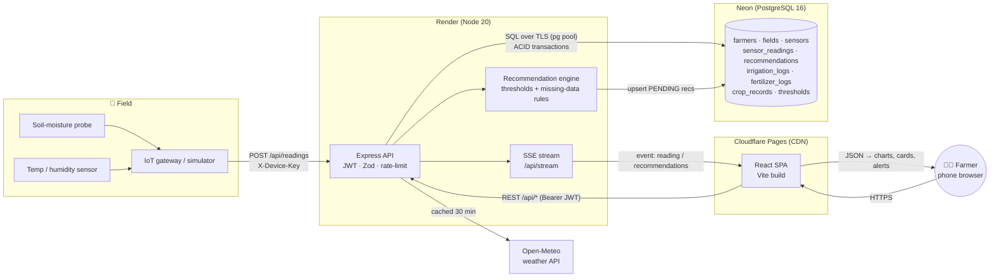

# Free Hosting Research — October 2026

Phase 2 deliverable. Free tiers changed a lot in 2024–2026: Fly.io, Heroku and PlanetScale dropped theirs, Netlify moved to credits, and Oracle halved its Arm allowance in June 2026. The figures below were checked against vendor docs and recent reviews on **1 Oct 2026**. Re-check before relying on them, since vendors change limits without notice.

Scores are out of 10 **for this project**: a React SPA, a Node/Express API with SSE, PostgreSQL with CHECK constraints, triggers and ACID transactions, run by a student or small team at zero cost.

---

## 2A. Frontend hosting

| | Cloudflare Pages | Vercel (Hobby) | Netlify (Free) | GitHub Pages | Firebase Hosting (Spark) |
|---|---|---|---|---|---|
| **Setup difficulty** (1 = easy) | 2 | 1 | 2 | 4 | 4 |
| **Bandwidth** | Unlimited static requests | 100 GB/mo fast data transfer | Credit-based: 300 credits/mo; 20 credits per GB | 100 GB/mo (soft) | 360 MB/**day** (~10 GB/mo) |
| **Builds** | 500/mo, 1 concurrent, **20 min** timeout | 45 min per build; 1 concurrent | **15 credits per production deploy** (≈ 20 deploys/mo if nothing else is used) | 10/hour soft; 10 min deploy timeout | Built locally / in CI |
| **Custom domain + HTTPS** | ✅ (100 per project) | ✅ (50 per project) | ✅ | ✅ (1 site per account/org) | ✅ |
| **Environment variables** | ✅ build + runtime | ✅ (1,000 per env) | ✅ | ❌ (only via Actions build step) | ❌ (via CI) |
| **CI/CD** | Git push → build, preview per PR | Git push → build, preview per PR | Git push → build, deploy previews | GitHub Actions | GitHub Action / CLI |
| **SPA routing** | `_redirects` (included) | `vercel.json` (included) | `_redirects` (included) | needs 404.html hack | `firebase.json` rewrite |
| **Commercial use on free** | ✅ | ❌ Hobby is non-commercial | ✅ | ✅ | ✅ |
| **What happens at the limit** | — | Deploys blocked | **Sites pause** until next month | Soft limit / email | Hosting disabled for the day |
| **Score** | **9.5** | 9 | 7 | 6.5 | 6 |

**Pick: Cloudflare Pages.** Unlimited static bandwidth, commercial use allowed, preview deploys, and the edge network has POPs in India. Vercel is equally easy and fine for a college project, but Hobby forbids commercial use, which matters if this becomes a real product. Netlify's 2025 credit model makes frequent deploys expensive: around 20 production deploys a month uses the whole allowance and then sites pause.

---

## 2B. Backend hosting (Node/Express)

| | Render (Free) | Oracle Cloud Always Free | Railway | Fly.io | Heroku | Replit |
|---|---|---|---|---|---|---|
| **Setup difficulty** | 2 | 8 (VM, firewall, TLS, systemd yourself) | 2 | 5 | 3 | 2 |
| **Free compute** | 512 MB RAM, shared CPU; 750 instance-hours/mo (one service 24/7) | Arm A1: **2 OCPU / 12 GB** (halved from 4/24 on 15 Jun 2026) + 2 AMD micro VMs | 0.5 GB RAM / 1 vCPU during trial | none | none | Starter: evaluation only |
| **Sleep** | Spins down after **15 min idle**; ~1 min cold start | Never sleeps | — | Trial machines stop after 5 min idle | Eco: sleeps after 30 min | Scales to zero |
| **Bandwidth** | 5 GB/mo outbound, then $0.15/GB | 10 TB/mo egress | in credit | — | — | — |
| **Database** | Free Postgres **expires after 30 days** (1 GB) | Self-host Postgres on the VM | One-click Postgres (uses credit) | Managed Postgres paid | Postgres from $5/mo | — |
| **Always-free vs trial** | ✅ Always free | ✅ Always free (card for identity check; capacity often "out of host" in popular regions) | ❌ $5 one-off **30-day trial** (card required), then $5/mo Hobby | ❌ 2 VM-hours / 7-day trial, then pay-as-you-go | ❌ No free tier since 2022; Eco $5/mo, Basic $7/mo | ❌ Always-on needs Core ($25) + Reserved VM |
| **SSE / WebSockets** | ✅ | ✅ | ✅ | ✅ | ✅ | ✅ |
| **Score** | **8.5** | 7 | 6 | 4 | 3 | 2.5 |

**Pick: Render free web service.** It's the only genuinely free, git-deployed Node host left. The 15-minute sleep is handled two ways:

1. The frontend shows *"server may be waking up"* and retries. SSE reconnects with backoff, and pages fall back to 60 s polling.
2. Optionally, an external pinger (e.g. cron-job.org every 10 min) calls `/api/health`. One service running 24/7 uses ~730 of the 750 free hours, so this fits. Use it sparingly and within Render's fair-use terms.

**Don't use Render's free Postgres.** It is deleted 30 days after creation. Use Neon (below).

---

## 2C. Database hosting

| | Neon (Postgres) | Supabase (Postgres) | TiDB Cloud Starter (MySQL) | MongoDB Atlas M0 | Firebase Firestore | PlanetScale |
|---|---|---|---|---|---|---|
| **Free storage** | 0.5 GB per project (up to 100 projects) | 500 MB DB + 1 GB files | 5 GiB row + 5 GiB columnar per instance (25 GiB across 5 free instances) | 512 MB | 1 GiB | — |
| **Free queries / compute** | 100 CU-hours/project/mo; autoscale to 2 CU | Unlimited API requests; 5 GB egress | 50 M Request Units/instance/mo | 100 ops/s, 500 connections | 50 K reads, 20 K writes, 20 K deletes **per day** | — |
| **Idle behaviour** | Auto-suspend after 5 min; resumes in < 1 s | **Project pauses after 1 week** inactive (manual restore) | Serverless, scales to zero | Pauses after 30 days without connections | Always on | — |
| **Real-time** | via app (LISTEN/NOTIFY) | ✅ Realtime: 200 concurrent, 2 M messages/mo | ❌ | Change streams | ✅ native listeners | — |
| **Fits our relational schema?** | ✅ Exactly: CHECK, triggers, generated columns, partial unique indexes | ✅ Exactly | ⚠ MySQL dialect; triggers / partial indexes need rewriting | ❌ Document store; no FK/CHECK/ACID across collections in the same way | ❌ NoSQL | ✅ |
| **Scalability** | Branching, autoscaling; paid plans per-usage | Paid Pro $25/mo; mature ecosystem | Horizontal scale-out (distributed SQL) | Sharding on paid tiers | Massive, but per-op billing | Excellent, but paid |
| **Free?** | ✅ Always free | ✅ Always free (2 active projects) | ✅ Always free (no card for first 5) | ✅ | ✅ Spark | ❌ **No free tier** since Apr 2024; from $5/mo (PS-5 single node) |
| **Score** | **9.5** | 9 | 7 | 4.5 | 4 | 3 |

**Pick: Neon.** It is standard PostgreSQL, so the `schema.sql` with CHECK constraints, triggers and generated columns runs unchanged. It never pauses for good (unlike Supabase's 7-day pause), resumes in under a second, and the seeded dataset is about 25 MB, roughly 5 % of the 0.5 GB quota. **Supabase is a drop-in alternative**: the same `DATABASE_URL` and the same schema. Pick it if you want its dashboard, auth or file storage later.

---

## 2D. Final recommendation

| Goal | Frontend | Backend | Database | Monthly cost | Trade-off |
|---|---|---|---|---|---|
| **🥇 Zero cost (recommended)** | Cloudflare Pages | Render Free | Neon Free | **₹0** | ~1 min cold start after 15 min idle |
| **Best performance** | Cloudflare Pages | Oracle Always Free A1 VM (2 OCPU / 12 GB), Node + Caddy | Neon Free (or Postgres on the same VM) | ₹0 (card for verification) | No sleep and fast, but you run the server: OS updates, TLS, backups, firewall |
| **Most scalable** | Cloudflare Pages (or Vercel Pro) | Railway Hobby ($5) or Render Starter ($7), scaled horizontally | Neon Launch (usage-based) or Supabase Pro ($25) | ~$5–35 | Always-on, multiple instances. Swap the in-process SSE bus for Postgres `LISTEN/NOTIFY` or Redis when running more than 1 instance |

### Data-flow / deployment diagram

**Request lifecycle (sensor → advice → farmer):**

1. A gateway posts a batch to `POST /api/readings`. Values that are null, non-numeric or out of range are stored as `status = 'MISSING'`, never dropped.
2. A single transaction upserts readings. The DB trigger refreshes `sensors.last_reading`.
3. The engine re-evaluates each affected field and upserts or expires recommendations. The partial unique index guarantees one open recommendation per rule.
4. The API publishes `reading` and `recommendations` events, and connected dashboards update live over SSE.
5. When the farmer taps **Mark as done**, one transaction locks the recommendation, marks it APPLIED and writes the irrigation or fertilizer log.

---

### Sources

- Render free tier: [justinmckelvey.com — Is Render free?](https://justinmckelvey.com/blog/is-render-free), [bex.co — Render free Postgres 30-day expiry](https://bex.co/blog/2026/09/23/render-free-postgres-30-day-expiry)
- [Supabase pricing](https://supabase.com/pricing) · [Neon free plan limits](https://neon.com/faqs/free-plan-limits-and-quotas)
- [Railway free/trial (SaaSPricePulse)](https://www.saaspricepulse.com/tools/railway) · [Fly.io free tier status (SaaSPricePulse)](https://www.saaspricepulse.com/tools/flyio)
- [Vercel limits docs](https://vercel.com/docs/limits) · [Vercel Hobby limits (DeployWise)](https://deploywise.dev/blog/vercel-free-tier-limits-2026)
- [Netlify pricing](https://www.netlify.com/pricing/) · [Cloudflare Pages limits](https://developers.cloudflare.com/pages/platform/limits/) · [GitHub Pages limits](https://docs.github.com/en/pages/getting-started-with-github-pages/github-pages-limits)
- [Firebase pricing](https://firebase.google.com/pricing) · [Firebase free tier 2026 (AgentDeals)](https://agentdeals.dev/vendor/firebase)
- [Oracle halves Always Free A1 (InfoQ, Jul 2026)](https://www.infoq.com/news/2026/07/oracle-cloud-free-tier-limits/)
- [TiDB Cloud Starter pricing details](https://www.pingcap.com/tidb-cloud-starter-pricing-details/) · [PlanetScale free tier alternatives (Layerbase)](https://layerbase.com/blog/planetscale-free-tier-alternatives)
- [MongoDB Atlas M0 limits (Solo Product Office)](https://soloproductoffice.com/archive/mongodb-atlas-free-tier-shared-cluster-limits/)
- [Heroku alternatives 2026 (SnapDeploy)](https://snapdeploy.dev/blog/best-heroku-alternatives-2026) · [Free hosting that doesn't sleep (livemy.app)](https://livemy.app/blog/free-hosting-that-doesnt-sleep) · [Replit pricing (livemy.app)](https://livemy.app/blog/replit-pricing)
